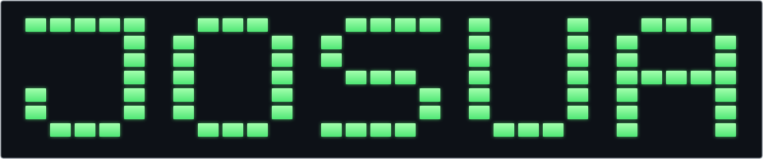

<p align="center">
  
</p>

<p align="center">
  <strong>Josua Cabanting · Engr_Owa</strong><br />
  <em>One idea. One commit. One step forward.</em>
</p>

<p align="center">
  <a href="https://github.com/josuacabanting"></a>
  <a href="https://github.com/josuacabanting/josuacabanting.github.io"></a>
  <a href="mailto:josuaocabanting@gmail.com"></a>
</p>

---

### `$ whoami`

> Hey, I'm Josua — **Engr_Owa** on GitHub.<br />
> Welcome to my workspace for personal projects, experiments, and ideas in progress.

```js
const josua = {
  name: "Josua Cabanting",
  alias: "Engr_Owa",
  github: "@josuacabanting",
  project: "josuacabanting.github.io",
  approach: "Learn. Build. Improve. Repeat.",
};
```

---

### `$ ls -la ~/projects`

<details open>
<summary><strong>🌐 Web projects</strong></summary>

| Project | Repository |
| :--- | :--- |
| Personal website | [josuacabanting.github.io](https://github.com/josuacabanting/josuacabanting.github.io) |

</details>

<details>
<summary><strong>🧪 More from my workspace</strong></summary>

Browse my [repositories](https://github.com/josuacabanting?tab=repositories) to see what I'm working on.

</details>

---

### `$ cat tech-stack.json`

```json
{
  "web": ["HTML"],
  "workspace": ["Git", "GitHub"],
  "mindset": "Always learning"
}
```

<!-- Add other technologies here as your stack grows. -->

---

### `$ cat contact.txt`

- **GitHub:** [@josuacabanting](https://github.com/josuacabanting)
- **Email:** [josuaocabanting@gmail.com](mailto:josuaocabanting@gmail.com)

<p align="center"><sub>Thanks for stopping by. See you in the next commit.</sub></p>


